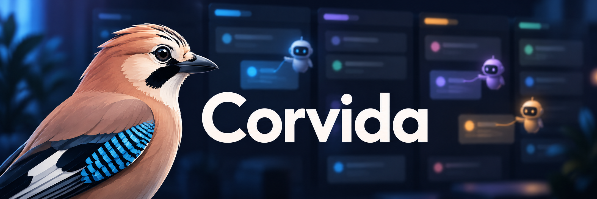

<div align="center">



# Corvida

**A cross-platform Kanban board suite — desktop app, REST API, and an MCP server so LLMs can manage your boards.**

[](LICENSE)
[](https://dotnet.microsoft.com/download)
[](https://avaloniaui.net/)
[](#)

</div>

---

Corvida is a Kanban board manager built around a shared core: a desktop client, a hosted REST API, and a Model Context Protocol (MCP) server that lets an LLM create boards, move tasks, and manage your workflow directly.

## Table of Contents

- [Features](#features)
- [Architecture](#architecture)
- [Installation](#installation)
  - [Desktop App](#desktop-app)
  - [REST API](#rest-api)
  - [MCP Server](#mcp-server)
  - [Web UI](#web-ui)
- [AI Tool Integration](#ai-tool-integration)
- [Authentication](#authentication)
- [Configuration](#configuration)
- [Development](#development)
- [Data Storage](#data-storage)
- [Contributing](#contributing)
- [License](#license)

## Features

- Create and manage multiple boards, with archive/restore for finished ones
- Organize tasks into customizable columns (e.g. To-Do, In Progress, Done)
- **Swimlane grid** — every board member gets a row, so each card sits at the intersection of a column and an assignee: drag it sideways to change status, up or down to reassign it. Ordering within a cell is persisted per board.
- Write task descriptions in Markdown
- Task priorities and planned start/end dates
- **Agents** — reusable board members (human or AI) with a name, color/avatar, and a Markdown "personality", assignable across any board
- **Skills** — create, edit, and install Claude-Code-style skills (`SKILL.md`) into Claude Code, OpenCode, or Hermes directly from the app
- **Install into your AI tooling** — export any Corvida agent as a Claude Code or OpenCode subagent, and register the bundled MCP server into Claude Code, OpenCode, or Hermes, all from the Settings page
- Runs on the desktop *or in the browser* — the same UI, compiled to WebAssembly
- **Optional login** — off by default; switch it on for password accounts, `Admin`/`User` roles, and revocable access keys for the MCP server
- Live updates across open clients via SignalR when using the REST API
- Light and dark theme support
- Store data locally as files, or centrally through the REST API
- Manage boards, tasks, and agents from an LLM via the bundled MCP server

## Architecture

Corvida is split into focused projects that share a common core:

| Project | Type | Role |
|---|---|---|
| `Corvida` | Desktop app | Avalonia UI client (Windows, macOS, Linux) |
| `Corvida.Web` | Avalonia Browser (WASM) | The same UI running in a browser, served by nginx |
| `Corvida.Shared` | Avalonia class library | ViewModels, views and dialogs shared by both UI hosts |
| `Corvida.Api` | ASP.NET Core | REST API backed by PostgreSQL, with a SignalR hub for live updates |
| `Corvida.Mcp` | Console (stdio) | MCP server exposing Kanban tools to LLMs |
| `Corvida.Core` | Class library | Shared models and service layer |
| `Corvida.AppHost` | .NET Aspire | Local orchestration of the API + PostgreSQL |
| `Corvida.ServiceDefaults` | Class library | Shared Aspire service defaults for `Corvida.Api` |
| `Corvida.Core.Tests` / `Corvida.Api.Tests` | xUnit | Unit tests for the core; integration tests for the API |

The desktop and browser clients share one UI in `Corvida.Shared`. The desktop app and MCP server both depend on `Corvida.Core` and can talk either to the local filesystem or to `Corvida.Api` over HTTP — see [Data Storage](#data-storage).

## Installation

### Prerequisites

- [.NET 10 SDK](https://dotnet.microsoft.com/download)
- [Docker](https://www.docker.com/) or [Podman](https://podman.io/) — needed to run `Corvida.Api` in a container, and for the API integration tests

### Desktop App

```bash
git clone https://github.com/k0zi/Corvida.git
cd Corvida/src
dotnet run --project Corvida/Corvida
```

By default the app stores boards and tasks locally under `~/CorvidaData/` — no server required.

To install a standalone build:

```bash
dotnet publish Corvida/Corvida/Corvida.csproj -c Release -o /path/to/install/dir
```

### REST API

The quickest way to stand up `Corvida.Api` + PostgreSQL from a bare Linux machine is the bundled installer, which installs Podman (or Docker) if it's missing, builds the image, and starts the stack:

```bash
./install.sh                    # installs Podman if needed, runs on :5083
./install.sh --engine docker    # use Docker instead (must already be installed)
./install.sh --port 5000        # expose on a different host port
```

It can also be run standalone (e.g. via `curl ... | bash`), in which case it clones the repo into `--dir` (default `~/corvida-api`) instead of using the current checkout. Run `./install.sh --help` for all options.

Alternatively, drive Compose directly (from the repo root):

```bash
docker compose up --build   # or: podman compose up --build
```

This builds the API image and starts it alongside PostgreSQL, exposing the API on `http://localhost:5083`.

> **Podman users going the manual `docker compose` route:** make sure the Podman API socket is running first, since Compose talks to it over the Docker-compatible API:
> ```bash
> systemctl --user enable --now podman.socket
> export DOCKER_HOST=unix:///run/user/$(id -u)/podman/podman.sock
> ```
> Not needed if you use `podman compose` directly, or the `install.sh` script above.

Alternatively, run everything locally with **.NET Aspire** for a dashboard and hot reload during development:

```bash
cd src
dotnet run --project Corvida.AppHost/Corvida.AppHost.csproj
```

### MCP Server

`Corvida.Mcp` exposes 22 tools (list/create/update/delete boards, groups, board members, tasks, and agents) over stdio via the `ModelContextProtocol` SDK.

The desktop app can write all of the configs below for you — see
[AI Tool Integration](#ai-tool-integration). To do it by hand:

**Claude Code** — register it globally so it's available in every project:

```bash
claude mcp add -s user corvida -- dotnet run -c Release --project /path/to/src/Corvida.Mcp/Corvida.Mcp.csproj
```

**Claude Desktop** — add it to `~/.config/claude/claude_desktop_config.json`:

```json
{
  "mcpServers": {
    "corvida": {
      "command": "dotnet",
      "args": ["run", "--project", "/path/to/src/Corvida.Mcp/Corvida.Mcp.csproj"]
    }
  }
}
```

**Hermes agent** ([hermes-agent.nousresearch.com](https://hermes-agent.nousresearch.com/)) — add it to `~/.hermes/config.yaml` under `mcp_servers`:

```yaml
mcp_servers:
  corvida:
    command: "dotnet"
    args: ["run", "--project", "/path/to/src/Corvida.Mcp/Corvida.Mcp.csproj"]
```

Then run `hermes chat` to discover and register the tools, or `/reload-mcp` if Hermes is already running.

### Web UI

`install.sh` brings the browser UI up alongside the API:

```
  Web UI:         http://localhost:8183
                  https://localhost:8283  (self-signed certificate)
```

Ports are configurable:

```bash
./install.sh --web-port 8183 --web-https-port 8283
./install.sh --no-web          # API and database only
```

**No configuration is needed.** nginx serves the WebAssembly bundle and proxies `/api`, `/connect`
and `/hubs` through to the API on the same origin, so there is no CORS to set up and no API address
to bake in. That same-origin arrangement is also what makes the HTTPS port work — a page served over
HTTPS is not allowed to call a plain-HTTP API.

The HTTPS certificate is self-signed and generated on first start, so browsers will warn about it.
It lives in the `webcerts` volume; replace it with a real certificate, or put a TLS-terminating
proxy in front, for anything beyond local use.

The first build compiles the WebAssembly bundle and takes several minutes.

If you rebuild the image after changing shared UI or model code and pages come up blank or show
`Not Found: …`, see the WebAssembly notes in `CLAUDE.md` — the browser build needs trimmer roots
and the System.Text.Json reflection path, and both fail silently without them.

If a rebuild seems to change nothing, force-reload the page once (Ctrl+Shift+R). Builds before this
note served the whole `_framework/` directory as immutable for a year, so a browser that loaded the
app back then keeps using its cached copy and never asks for the new one.

To run it from source instead:

```bash
cd src
dotnet run --project Corvida.Web/Corvida.Web.csproj    # http://localhost:5180
```

In that mode the app reads `wwwroot/config.json`, which points at `http://localhost:5083` — the API
is then a separate origin, which the API's default CORS list already allows.

## AI Tool Integration

Beyond the MCP server, the desktop app's **Settings** page can write Corvida's own content into the
config folders of the AI tools you already use. Each entry has an editable target path and an
Install / Uninstall pair, so nothing is written anywhere you did not point it at.

| Section | What it writes | Default targets |
|---|---|---|
| **Install Skills** | The Kanban skills (`corvida-plan`, `corvida-implement`) as `SKILL.md` + `agents/openai.yaml` | `~/.claude/skills`, `~/.config/opencode/skills`, `~/.hermes/skills` |
| **Install Agents** | Every Corvida agent as a subagent definition, in that tool's own format | `~/.claude/agents`, `~/.config/opencode/agent` |
| **Install MCP Server** | A single `corvida` entry merged into the tool's existing config file | `~/.claude.json`, `~/.config/opencode/opencode.json`, `~/.hermes/config.yaml` |

A few things worth knowing:

- **Skills** are editable in-app from the **Skills** page. The bundled ones are seeded once into
  `{AppData}/Corvida/skills/`, and everything installs from there — your edits survive upgrades.
- **Agents** are exported as subagents, with the agent's Markdown personality as the system prompt.
  Corvida tracks which files it wrote in `{AppData}/Corvida/agent-installs.json`: it will never
  overwrite a hand-written subagent of yours that happens to share a name — it reports it as a
  conflict — and uninstall removes only the files it created. Hermes is not a target here, since its
  subagents are spawned at runtime rather than read from disk.
- **MCP Server** install merges into the real config file and touches no other key, so Claude Code's
  `~/.claude.json` keeps its project history. Uninstall removes just the `corvida` entry.

## Authentication

**Login is off by default.** A fresh install behaves exactly as it always has: anyone who can reach
the API has full access. Authentication is a switch you turn on, and turning it off again wipes the
user store.

### Turning it on

From the desktop app's **Settings** page, or directly:

```bash
curl -X POST http://localhost:5083/api/auth/enable \
  -H 'Content-Type: application/json' \
  -d '{"Email":"you@example.com","Password":"choose-a-strong-one","DisplayName":"Admin"}'
```

This creates the first administrator and closes the gate in one step. **Whoever calls it first
becomes the only administrator**, so do it immediately after installing — while login is off, the
endpoint has no credentials to check. It is rate-limited (3 attempts / 5 minutes per IP) and only
reachable from the origins listed in `Auth:AllowedOrigins`.

Clients then sign in at the token endpoint:

```bash
curl -X POST http://localhost:5083/connect/token \
  -d 'grant_type=password&username=you@example.com&password=...&scope=offline_access'
```

### Roles

| Role | Can do |
|---|---|
| `Admin` | Everything, plus user management and the auth switch |
| `User` | Boards, tasks, agents |

Administrators manage accounts from the desktop app's **Users** page, which only appears when login
is required and the signed-in user is an administrator.

### The MCP server

The MCP server runs over stdio and cannot show a login screen, so it authenticates with a key
instead. Generate one on the Settings page under **Access Keys**, then press *Use for the MCP
server* to write it into `settings.json` — the same file the desktop app already shares with it.
Keys can be revoked at any time, and the raw value is shown only once.


### Turning it off

Requires an administrator's own password and an explicit confirmation phrase:

```bash
curl -X POST http://localhost:5083/api/auth/disable \
  -H "Authorization: Bearer $TOKEN" -H 'Content-Type: application/json' \
  -d '{"Password":"...","Confirm":"DELETE ALL USERS"}'
```

This **permanently deletes every account, role assignment and token**, rotates the signing keys (so
tokens issued earlier stop working immediately), disconnects live clients, and returns the system to
the open default.

### Locked out?

There is no password-reset email and no recovery endpoint. If the administrator password is lost,
reopen the gate directly in the database and start over:

```bash
docker compose exec db psql -U postgres -d corvida \
  -c 'UPDATE auth."SystemSettings" SET "AuthRequired" = false WHERE "Id" = 1;'
docker compose restart api
```

The API is then open again, and `POST /api/auth/enable` will refuse until you also clear the old
accounts (`TRUNCATE auth."AspNetUsers" CASCADE;`).

### Upgrading an existing database

The API applies its migrations on startup. If yours was created while the migration files were
missing from the repository, its `__EFMigrationsHistory` can lag behind the schema it actually has,
and startup then fails with something like:

```
column "CellOrdersJson" of relation "Boards" already exists
```

That means the columns are present but the corresponding rows were never recorded. Check what is
recorded against what exists:

```bash
docker compose exec db psql -U postgres -d corvida \
  -c 'SELECT "MigrationId" FROM "__EFMigrationsHistory" ORDER BY 1;' -c '\d public."Boards"'
```

If the schema already matches the newest migration, record the missing rows rather than re-running
them — this changes no data:

```bash
docker compose exec db psql -U postgres -d corvida -c '
INSERT INTO "__EFMigrationsHistory" ("MigrationId", "ProductVersion") VALUES
  (''20260804164707_AddUsersAndAssignment'', ''10.0.10''),
  (''20260804175624_RenameUsersToAgents'',   ''10.0.10''),
  (''20260806062534_AddAgentDescription'',   ''10.0.10'')
ON CONFLICT ("MigrationId") DO NOTHING;'
docker compose restart api
```

Only stamp a migration whose effects you have confirmed are already in the schema. Do **not**
`docker compose down -v` to work around this — that deletes every board.

### Security notes

- The default deployment serves **plain HTTP**. Bearer tokens — and, because the desktop app uses
  the password grant, passwords themselves — travel unencrypted. Put a TLS-terminating reverse proxy
  in front of the API before exposing it beyond localhost, then set `Auth__AllowInsecureTransport=false`.
- `Auth__AllowedOrigins__0` must name wherever `Corvida.Web` is served from; browsers on any other
  origin are refused.
- Signing keys are stored in the database, so tokens survive `docker compose restart`.

## Configuration

App settings live at `{AppData}/Corvida/settings.json`, shared by the desktop app and MCP server:

```json
{
  "DataPath": "~/CorvidaData",
  "StorageMode": 0,
  "ServerUrl": "http://localhost:5083/",
  "ApiKey": null
}
```

| Field | Description |
|---|---|
| `DataPath` | Where local boards/tasks are stored (`StorageMode: LocalFolder` only) |
| `StorageMode` | `0` = `LocalFolder`, `1` = `ServerHosted` |
| `ServerUrl` | Base URL of `Corvida.Api` (`StorageMode: ServerHosted` only) |
| `ApiKey` | Access key for the MCP server, generated on the Settings page. Only needed once login is required. Stored in plain text — treat this file as a credential. |

## Development

```bash
cd src
dotnet build                        # build all projects
dotnet test                         # run all tests
dotnet test --filter "FullyQualifiedName~SomeTest"   # run a single test
```

`Corvida.Api.Tests` spins up a real PostgreSQL container per run via Testcontainers, so a container
engine has to be running for those. With Podman, point Testcontainers at its socket:

```bash
systemctl --user enable --now podman.socket
printf 'docker.host=unix:///run/user/%s/podman/podman.sock\n' "$(id -u)" >> ~/.testcontainers.properties
```

`Corvida.Core.Tests` needs nothing beyond the SDK.

## Data Storage

Two modes, controlled by `AppSettings.StorageMode`:

- **LocalFolder** *(default)* — everything lives under `~/CorvidaData/`:

  ```
  boards/{boardId}/board.json          Board and its columns
  boards/{boardId}/tasks/{taskId}.md   One task: YAML frontmatter + Markdown description
  agents/{agentId}.md                  One agent: YAML frontmatter + Markdown personality
  ```

  Plain files, so they diff and version-control cleanly.

- **ServerHosted** — the desktop app, the browser UI and the MCP server talk to `Corvida.Api` over
  HTTP instead, which persists boards, tasks and agents in PostgreSQL and pushes changes to every
  connected client over SignalR.

## Contributing

Issues and pull requests are welcome. Please open an issue to discuss significant changes before submitting a PR.

## License

Corvida is licensed under the [MIT license](LICENSE). The desktop package, the browser UI and the API
container also redistribute third-party components (the .NET runtime, Avalonia, SkiaSharp, the Inter font,
Material Design Icons, OpenIddict, Npgsql, …) under their own licenses; see
[THIRD_PARTY_NOTICES.md](THIRD_PARTY_NOTICES.md) and the `licenses/` directory. The `.deb` installs these to
`/usr/share/doc/corvida/`, the API image carries them in `/usr/share/doc/corvida/`, and the web container
serves them at `/THIRD_PARTY_NOTICES.md` and `/licenses/`.
